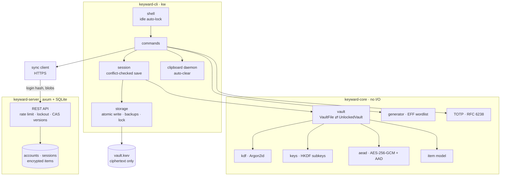

# Keyward

A self-hosted, zero-knowledge password manager written in Rust. It is a
learning and portfolio project that puts correctness, clarity and tests ahead
of features.

- **Argon2id → HKDF → AES-256-GCM.** Vault-key wrapping, with item ciphertext
  bound to `(vault, item, version)`.
- **Encrypted index.** Detects swapped, deleted, duplicated or rolled-back
  items.
- **No `unsafe`, no home-made crypto.** Only RustCrypto crates.
- **`kw` CLI.** Clipboard auto-clear, password and passphrase generator,
  TOTP, and an interactive shell that auto-locks.
- **Zero-knowledge sync server** (axum + SQLite). It stores only ciphertext.
  Per-item versions are checked on the server and conflicts are resolved on
  the client.

> **Status:** Phase 2 (core, local CLI, sync server). Not audited. Read
> [SECURITY.md](SECURITY.md) before trusting it with anything.

## Architecture



```text
password ─Argon2id─▶ MasterKey ─HKDF("wrap")─▶ WrapKey ─AES-GCM─▶ wrapped VaultKey
                               └HKDF("auth")─▶ AuthKey ─SHA-256─▶ LoginHash (sync server)
VaultKey (random) ─AES-GCM─▶ index + every item
```

More detail:
- [docs/architecture.md](docs/architecture.md): crates, data flow, saving,
  memory hygiene, test strategy
- [docs/vault-format.md](docs/vault-format.md): the on-disk format, byte by
  byte
- [docs/threat-model.md](docs/threat-model.md): adversaries, design decisions
  and known gaps
- [docs/server.md](docs/server.md): running the sync server, configuration,
  protocol and API

## Install

```sh
cargo install --path crates/keyward-cli     # installs the `kw` binary
```

The default vault is `<local data dir>/keyward/vault.kwv`:
- Windows: `%LOCALAPPDATA%`
- Linux: `~/.local/share`
- macOS: `~/Library/Application Support`

Override it with `--vault PATH` or `KW_VAULT=PATH`.

## Usage

```console
$ kw init
New master password:
Repeat new master password:
Created vault at ~/.local/share/keyward/vault.kwv (Argon2id: 64 MiB, 3 passes, 1 lane(s))

$ kw add GitHub -u octocat --url https://github.com -t work --totp
Master password:
Password for GitHub:
Repeat password for github:
TOTP secret (base32 or otpauth:// URI):
Added "GitHub" (3f9c2a1b)

$ kw add "Bank" -u me --generate --length 32
Added "Bank" (8d01e6c4)
A password was generated; copy it with `kw get 8d01e6c4`.

$ kw list
ID        TITLE   USERNAME  URL
8d01e6c4  Bank    me
3f9c2a1b  GitHub  octocat   https://github.com

$ kw get github                      # copies the password; cleared after 20 s
Copied the password of "GitHub" to the clipboard; it will be cleared in 20 s.

$ kw get github -f totp --show       # print the current TOTP code
(valid for 17 more seconds)
492039

$ kw get github -f details           # everything except secrets
$ kw search work
$ kw edit github --generate --add-tag dev     # old password kept in history
$ kw rm bank
Delete "Bank" (8d01e6c4)? [y/N] y

$ kw gen -l 24 -a                    # random characters, no look-alikes
$ kw gen --passphrase -w 6 --capitalize --digit
Zen-Rectify9-Putt-Jockstrap-Reheat-Gloomily
entropy: 83.5 bits (strong)

$ kw change-master-password --kdf-memory-mib 256   # also raises Argon2 cost

$ kw shell --idle-timeout 120        # unlock once, auto-lock after 2 min idle
kw> list
kw> get github -f username --show
kw> lock
kw (locked)> exit
```

Items can be named by exact title, a unique search hit, or an id prefix
(4 or more hex characters).

For scripts and tests, `--password-stdin` reads each password as one line from
stdin instead of the terminal.

### Sync

```console
$ KW_DOMAIN=vault.example.com docker compose up -d --build   # server + Caddy (HTTPS)
$ docker compose -f docker-compose.yml -f compose.local.yml up --build   # local try-out

$ kw sync register --server https://vault.example.com --username alice
Registered "alice" on https://vault.example.com.
Synced: received 0 change(s), removed 0, sent 2, deleted 0 on server, 0 conflict(s) resolved.

$ kw --vault laptop.kwv sync clone --server https://vault.example.com --username alice
$ kw sync            # pull + push; also available inside `kw shell`
$ kw sync status
```

See [docs/server.md](docs/server.md) for configuration and the protocol.

## Development

```sh
cargo fmt --all
cargo clippy --all-targets -- -D warnings
cargo test --workspace
```

The crates are laid out as follows:
- `keyward-core`: crypto, vault format, item model, generator, TOTP. Unit
  tests, proptests and a golden fixture.
- `keyward-cli`: the `kw` binary. Unit tests and end-to-end `assert_cmd`
  tests, including two "devices" syncing through a real server.
- `keyward-server`: the sync server. API tests against in-memory SQLite with
  an injectable clock.

Roadmap:
- Phase 3: ratatui TUI

## License

MIT OR Apache-2.0. The embedded EFF large wordlist is © Electronic Frontier
Foundation, CC BY 3.0 US.
