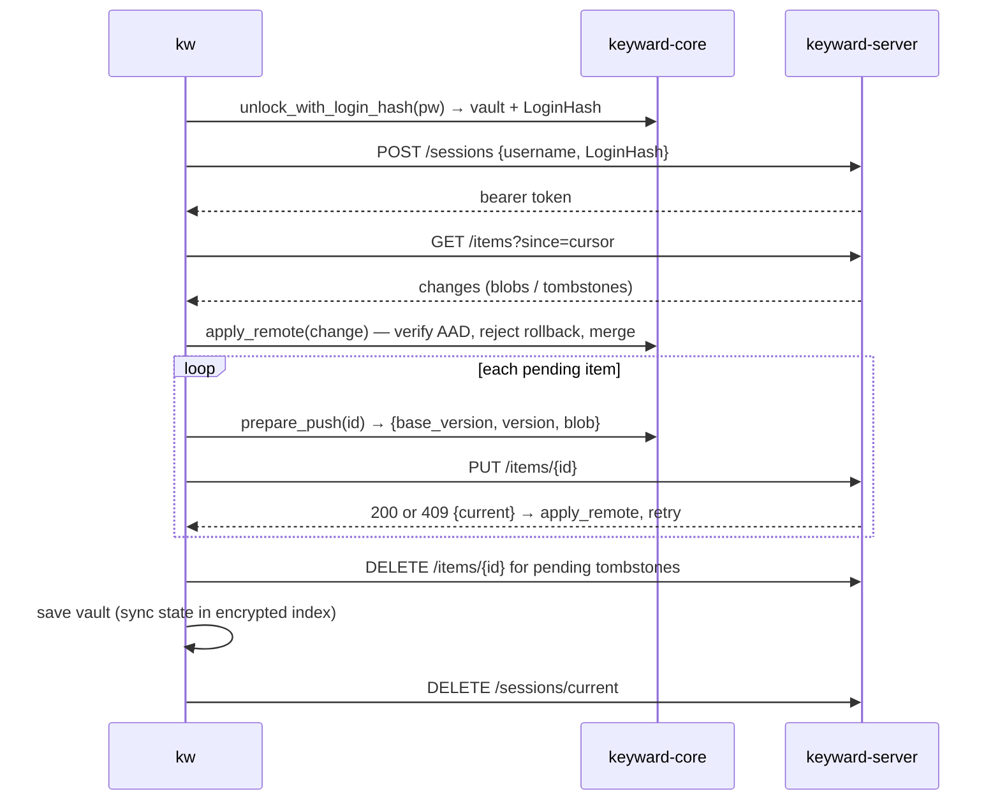
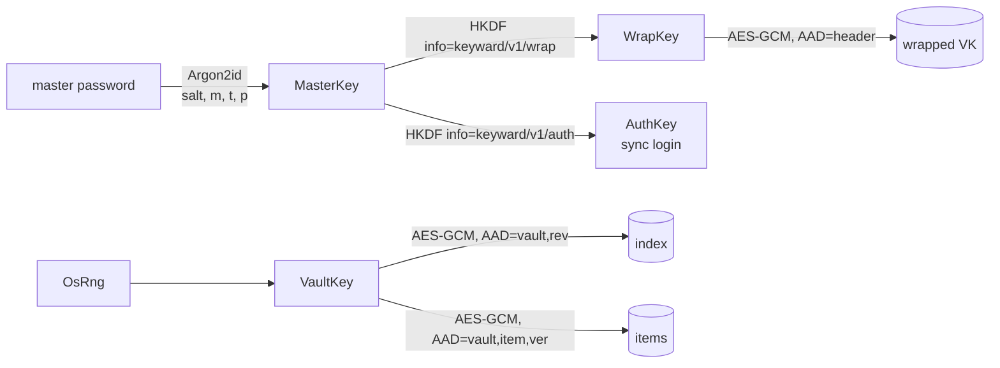

# Architecture

## Crates

| Crate | Role | I/O |
|---|---|---|
| `keyward-core` | KDF, key hierarchy, AEAD, item model, vault format, generator, TOTP | none: bytes in, bytes out |
| `keyward-cli` (`kw`) | Commands, prompts, clipboard, atomic storage, interactive shell | filesystem, terminal, clipboard |
| `keyward-server` | axum + SQLite sync server that stores only ciphertext ([docs/server.md](server.md)) | network, DB |
| `keyward-tui` (`kw-tui`) | ratatui client. `App` is a pure state machine (keys in, actions out) and `ui::draw` is a pure render, both tested without a terminal | terminal, clipboard |

`keyward-core` doing no I/O keeps it easy to test exhaustively (property tests
and known-answer tests) and lets the CLI, TUI and server share it unchanged.

## Data flow: `kw get github`

```mermaid
sequenceDiagram
    participant U as User
    participant CLI as kw (cli)
    participant S as storage
    participant C as keyward-core
    participant D as clipboard daemon
    U->>CLI: kw get github
    CLI->>S: read_vault(path)
    S-->>CLI: VaultFile (ciphertext)
    CLI->>U: Master password? (no echo)
    CLI->>C: VaultFile::unlock(pw)
    C->>C: Argon2id → MK → HKDF → WK
    C->>C: open(WK, wrapped VK) → open(VK, index) → verify items → open items
    C-->>CLI: UnlockedVault
    CLI->>CLI: resolve("github") → ItemId
    CLI->>D: spawn detached, secret via stdin pipe
    D-->>CLI: "ok"
    CLI-->>U: Copied; clears in 20 s
    Note over D: sleep 20 s; clear if unchanged
```

## Data flow: `kw sync`



## Key hierarchy



## Saving

`Session::save` runs in this order:

1. Take the exclusive `vault.kwv.lock`.
2. Re-read the file and refuse to save if its revision is no longer the one we
   unlocked.
3. `UnlockedVault::seal`: re-encrypt dirty items, rebuild the index, and
   increase the revision.
4. `storage::write_atomic`: write a temp file and fsync it, rotate
   `.bak.1..3`, rename over the vault, then fsync the directory (Unix).

## Memory hygiene

- Keys are `SecretBox<[u8; 32]>` inside newtypes. They zeroize on drop and
  print `[REDACTED]` in `Debug`.
- `Login` derives `ZeroizeOnDrop`. Its secret fields are `SecretString`.
- Plaintext JSON is produced in exact-size `Zeroizing<Vec<u8>>` buffers. A
  counting pass runs first so the buffer never reallocates.
- AES and GCM key schedules zeroize on drop (the `aes-gcm` `zeroize` feature).
- `kw shell` keeps the session in `Arc<Mutex<Option<Session>>>`. The idle
  watchdog sets it to `None`, which drops and zeroizes everything.

The known limits are listed in [SECURITY.md](../SECURITY.md).

## Testing strategy

| Layer | Technique |
|---|---|
| KDF | RFC 9106 Argon2id vector, parameter floor and ceiling tests |
| HKDF | Known-answer value computed independently (Python `hmac`) |
| AEAD | proptest round-trip; proptest single-bit flips in nonce, ct and AAD |
| Vault | Tamper tests: swap, rollback, delete, duplicate, cross-vault, header and KDF downgrade, revision. proptest: a bit flip anywhere never yields *different* contents. A test documents that whole-file rollback is undetectable. |
| Format | Golden `v1.kwv` fixture must open forever |
| Generator | Class coverage, exact entropy, χ² uniformity, EFF list integrity |
| TOTP | RFC 6238 Appendix B (SHA1/256/512), RFC 4226 Appendix D |
| CLI | Unit tests (storage, lock, conflict detection, idle timer) and end-to-end `assert_cmd` runs of every command, including the shell |
| Sync logic | Scenario tests plus a proptest: two devices doing random offline add, edit and delete operations always converge with nothing pending. Tests for forged, relabelled, moved and rolled-back blobs. |
| Server | API tests on in-memory SQLite: version conflicts, tombstones, pagination, account isolation, expiry, lockout (including unknown users), rate limit, password change revoking sessions, no plaintext in the DB |
| TUI | `App` key handling (unlock, search, categories, copy actions, reveal timeout, auto-lock, palette, forms, generator, delete), rendering via `TestBackend` (secrets masked until revealed, locked screen shows no item data, tiny terminals don't panic), fuzzy ranking |
| End to end | `kw` binaries for two "devices" against a real server on a random port: register, clone, edit, delete, conflict, password change, shell |
